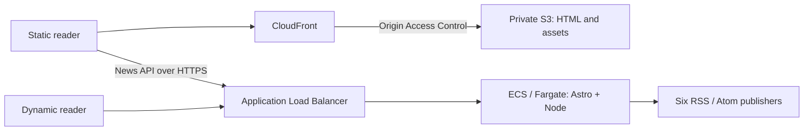

# Andrei Turcan — Software Notes

[](https://github.com/Installity/cs4421-astro-blog/actions/workflows/ci.yml)
[](https://github.com/Installity/cs4421-astro-blog/actions/workflows/deploy-static.yml)

A personal Astro blog about building software, learning through prototypes, and following technology news. The site combines project writing with a portfolio-inspired cream/charcoal design, red accents, locally hosted Geist fonts, and animated dotted waves.

## Content and experience

- **Home, Blog, and About:** two first-person software articles exploring Velsat’s CanSat sensor integration and radio telemetry, and ExGlass’s camera processing, classification, alerts, and prototype limitations.
- **Reading tools:** search, topic filters, reading time, author profiles, related articles, RSS, and a sitemap.
- **Tech News:** publisher-filtered headlines from TechCrunch, The Verge, Ars Technica, Irish Tech News, TechCentral.ie, and TechBuzzIreland, with six recent headlines on Home. Links open the original publisher articles.
- **Accessibility:** responsive layouts, light/dark themes, keyboard navigation, and background animation that can be paused and respects reduced-motion preferences.

## Technical design

See [ADR-001: static delivery and the containerized Astro server](docs/adr/ADR-001-transition-to-ssr-and-containers.md) for the architecture decision, alternatives, and operational tradeoffs.

Astro components and shared layouts render typed Markdown/MDX content collections. Native browser scripts handle themes, canvas animation, and news interactions; TypeScript supports the application and AWS CDK infrastructure.

### Architecture and decisions



The static site can display live headlines because its browser JavaScript calls the
separate API. That does not make its HTML server-rendered. The server build adds
request-time routes and APIs; article routes explicitly remain prerendered.

| Decision | Reason | Tradeoff |
| --- | --- | --- |
| Keep static reading on S3/CloudFront | Cacheable articles remain readable independently of the news process | Content changes require a build and CDN invalidation |
| Add the Node runtime on ECS/Fargate | Centralize feed parsing, caching and failure handling; expose dynamic health | Container, load-balancer and logging operations add cost and complexity |
| Reuse one Astro source for two outputs | Share content, components and tests | Separate releases and cross-origin configuration must remain compatible |
| Deploy tested images by digest | Trace source to exact image bytes and restore an existing artifact | Recovery depends on retained images and verified deployment history |

Static articles do not inherently need SSR. A serverless news aggregator would
also be viable; the Node/ECS implementation reuses this application and demonstrates
the course's container delivery path. CDK defines the static stack; ECS Express
manages the container service and its associated resources separately.

The Node server exposes `GET /api/news`, using native `fetch` and `rss-parser` for RSS/Atom. Six fixed feeds are fetched concurrently with an eight-second timeout and a 2 MB limit per source. Headlines are normalized, deduplicated, and sorted; output uses plain text and HTTP/HTTPS links. Each source has a 15-minute memory cache, shared refresh requests, and up to 24 hours of stale data after failures. Manual refresh (`GET /api/news?refresh=1`) can revalidate before the normal cache expires, with a shared 30-second manual cooldown per source and the existing one-minute failure backoff. Deferred checks are identified in the response; check times and publisher fetch times remain distinct. Partial outages retain working sources. Caches reset on restart and are independent across instances. Refresh feedback appears immediately, preserves readable headlines during the request, and fades changed results in over 320 ms unless reduced motion is enabled.

News loads on page entry and refreshes every 15 minutes while the tab is visible. There is no scheduled polling without visitors.

The custom domain addresses are [andreitrn.me](https://andreitrn.me/) for the static blog and [ssr.andreitrn.me](https://ssr.andreitrn.me/) for the ECS site. Their certificate, routing and DNS cutover steps are in the [custom-domain runbook](docs/operations/custom-domains.md); configuration in Git alone does not make a domain live. The separate [CloudFront URL](https://d2lpj15qx37gqq.cloudfront.net/) and [ECS HTTPS URL](https://as-2b62f684bea24081892fa30f44c134ca.ecs.us-east-1.on.aws/) remain available for assessment and recovery.

Canonical links, RSS and the sitemap use the custom domain for the selected static or server build; `PUBLIC_SITE_URL` can override it at build time. CloudFront redirects `www.andreitrn.me` to the root domain, retaining paths and queries. Portraits are bundled locally instead of relying on expiring external image links.

## Running and configuration

Use Node.js 22.12 or newer:

```sh
npm ci
npm run dev -- --background
```

Manage the preview with `npx astro dev status`, `npx astro dev logs`, and `npx astro dev stop`.

`npm run build` produces a static site. `ASTRO_OUTPUT=server npm run build` produces the Node server, including `/api/news` and `/api/health`; the Dockerfile uses this server configuration.

Server deployments use same-origin news requests. Static builds require `PUBLIC_NEWS_API_URL`, set before building to a complete HTTPS endpoint on a running server. Set that server’s `NEWS_ALLOWED_ORIGINS` to the permitted static-site origins, separated by commas. Without an API URL, static pages display a clear unavailable state. See [.env.example](.env.example).

## Demonstrating the SDLC

A concrete example is the [news-refresh story #71](https://github.com/Installity/cs4421-astro-blog/issues/71)
and its [implementation PR #90](https://github.com/Installity/cs4421-astro-blog/pull/90):

1. **Requirements:** immediate refresh feedback, retained readable headlines and observable acceptance criteria.
2. **Design:** shared API revalidation, bounded publisher requests, stale fallback and accessible reduced-motion behavior.
3. **Implementation and review:** a focused feature branch, Conventional Commits and a PR connecting the change to its story. Human review is distinct from automated checks.
4. **Verification and delivery:** API/browser tests exercise success and failure; main releases the static output and the tested container artifact.
5. **Operation and improvement:** logs and deployed checks inform follow-up work. For example, [PR #95](https://github.com/Installity/cs4421-astro-blog/pull/95) added graceful listener draining and a CI shutdown gate after a healthy endpoint alone proved insufficient to validate container lifecycle behavior.

GitHub Actions runs lint, Astro checks, unit tests, Chromium/WebKit browser tests, production builds, CDK tests/synthesis, and container health checks. Feed fixtures cover parsing, caching, timeouts, and outages; browser checks cover navigation, filtering, themes, and responsive layouts. Run `npm run lint`, `npm run check`, and `npm test` locally after installing CDK dependencies with `npm ci --prefix cdk`.

The static workflow runs independently on main pushes. Container CI validates pull requests without publishing or deploying; on main pushes it publishes the tested image to ECR, updates ECS using its immutable digest, and verifies health and news for each allowed origin. Both release paths should be checked after a merge. The static workflow defaults to this ECS API; a GitHub Actions `PUBLIC_NEWS_API_URL` variable can override it. OIDC permissions are scoped to this repository and service. See [deployment details](deployment/README.md) and [review screenshots](docs/verification/README.md).
